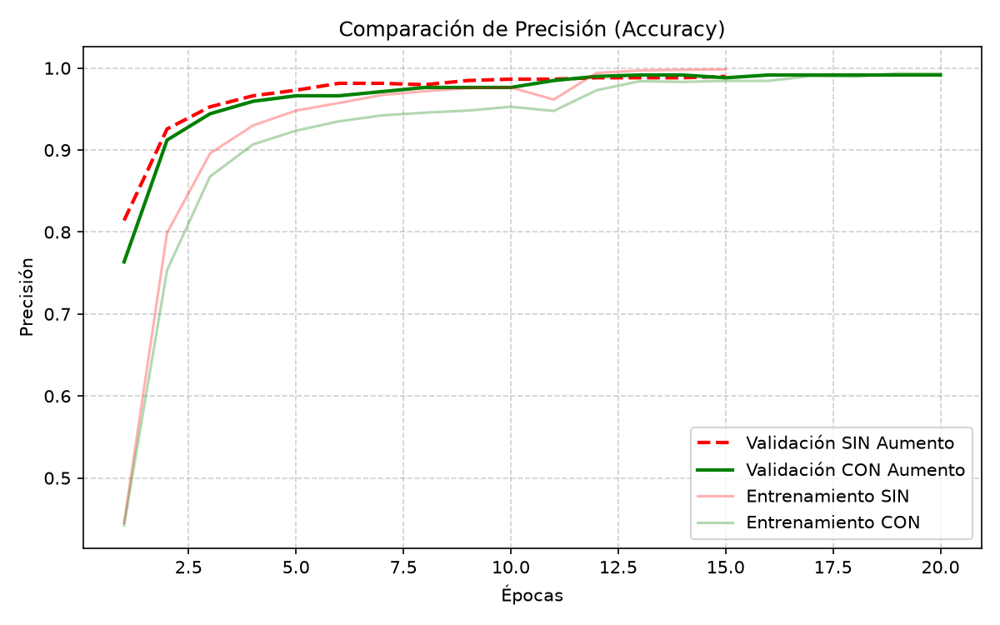
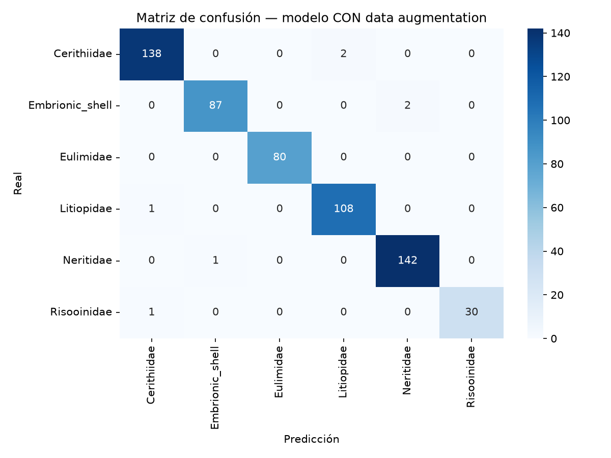

# Clasificación de familias de caracoles con Transfer Learning

Clasificación de imágenes SEM de caracoles en **6 familias**
(`Cerithiidae`, `Embrionic_shell`, `Eulimidae`, `Litiopidae`,
`Neritidae`, `Risooinidae`) usando **ResNet50** preentrenado en ImageNet.

## Contenido

- `Caracoles.ipynb` — notebook con el flujo completo (Colab / Jupyter)
- `Caracoles.py` — versión script para ejecución en clúster (SLURM)
- `Caracoles_original.ipynb` — versión inicial del ejercicio

## Flujo de trabajo

1. **Carga del dataset**: el zip se descomprime automáticamente;
   estructura esperada `CARACOLES/<familia>/*.png`
2. **Split** 80/20 entrenamiento/validación (`seed=123`)
3. **Estandarización**: resize a 160×160 y `preprocess_input` de ResNet50
4. **Comparación de dos modelos**: con y sin *data augmentation*
   (flip, rotación, zoom, contraste)
5. **Extracción de características**: base congelada +
   `GlobalAveragePooling2D → Dropout(0.2) → Dense(6)`
6. **Fine-tuning**: últimas 40 capas descongeladas, `lr=1e-5`
7. **Evaluación**: reporte de clasificación y matriz de confusión por modelo

## Resultados

- Modelo SIN augmentation: **~99.3%** accuracy en validación
- Modelo CON augmentation: **~98.8%** accuracy en validación
## Resultados




## Ejecución en clúster (SLURM)

Ejemplo de script de entrega (`run_caracoles.sh`):

```bash
#!/bin/bash
#SBATCH --job-name=caracoles
#SBATCH --partition=gpu
#SBATCH --gres=gpu:1
#SBATCH --cpus-per-task=8
#SBATCH --mem=32G
#SBATCH --time=04:00:00

python Caracoles.py
```
"# Clasificacion-Caracoles-Resnet50" 
